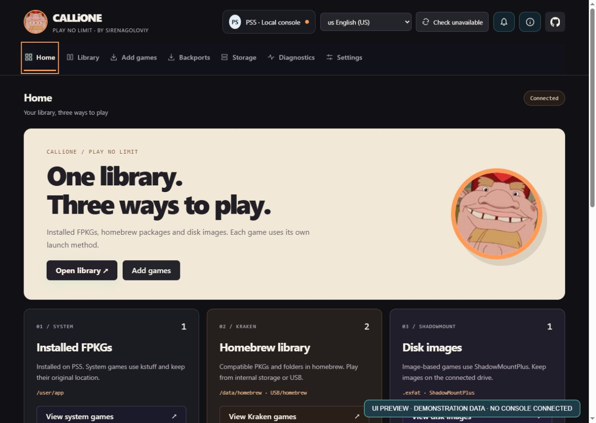
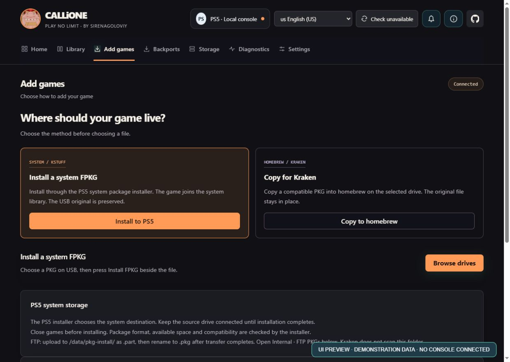

<h1 align="center">🎮 CALLiONE</h1>

<b>One PS5. One dashboard. Your games.</b> PLAY NO LIMIT · by SirenaGoloviy

✅ Tester-approved · 🌍 English / Русский · 🛠️ Built from TITAN

CALLiONE brings system FPKGs, Kraken homebrew and ShadowMount images into one interface for a jailbroken PS5. Each format keeps its own launch path.

[📥 Download CALLiONE 1.1.1](https://github.com/grimmtroll2285-dot/CALLiONE/releases/tag/v1.1.1) · [Try the web demo](https://grimmtroll2285-dot.github.io/CALLiONE/) · [Русский](#callione-ru)

### 🆕 CALLiONE 1.1.1 is available

⚙️ Bundled kstuff updated to **1.15-dr-test4**. Both ELF build stages and embedded input identity were verified. Console testing of this update is pending.

### ⚡ What it does

| Your games | How they run |
| --- | --- |
| 🎮 System-installed FPKGs | PS5 system + kstuff |
| 🐙 Compatible PKGs and game folders in `homebrew` | Kraken + AMPR |
| 💿 Supported images, including `.exfat` | ShadowMountPlus |
| 🎮 PS4 games on supported USB storage | PS4Mount with manual mount and unmount |

📦 System installation and homebrew copying are separate actions. CALLiONE also provides installation progress, storage tools, diagnostic logs and game-specific PlayGo / backport settings.

**✅ Tester-approved build:** testers report that the included features work as expected on their consoles. Compatibility still depends on the firmware, game version, package and backport. PS4Mount is integrated into this build with manual controls.

### 🆕 What changed in 1.1

- Updated the bundled kstuff to **1.15-dr-test3-stable**.
- Adapted selected Kraken Mount 0.4.0 fixes for metadata, settings, cache recovery and game startup sound.
- Moved manual PS4Mount into the main dashboard under **PS4 USB**. Games are mounted only when selected.
- Updated the CALLiONE avatar. PlayGo selection and separate local backport folders remain available.

**Backports:** use `homebrew/kraken-backports/<TitleID>/` for Kraken and `homebrew/backports/<TitleID>/` for system-installed FPKGs and ShadowMount images.

### 🖥️ Inside CALLiONE

*Actual PC interface previews with demonstration data; no console connected. Banner above is generated artwork.*

<b>📸 More screenshots — Library & Add games</b>

<b>📖 Quick start</b>

1. Fully restart the PS5, run your usual jailbreak and send the CALLiONE 1.1 ELF through Payload Manager. Do not run separate copies of kstuff, Kraken, ShadowMountPlus or PS4Mount alongside it.
2. Open the CALLiONE tile or `http://PS5-IP:8098/`.
3. **Add games → Install to PS5:** select a compatible FPKG on USB or in `/data/pkg-install/`. The system chooses the destination; wait for installation to finish before disconnecting USB.
4. **Copy to homebrew:** prepares the Kraken library separately from system installation. Its roots are `/data/homebrew/` and `homebrew/` on supported external drives. Images use ShadowMountPlus.
5. **PS4 USB:** start PS4Mount from its page, select a game and press **Mount**. Close the game, then press **Unmount**. Do not use Rest Mode while PS4Mount is active.

**FTP:** upload to `/data/pkg-install/`, which Kraken does not scan. Finish the transfer before installing; `.part` → `.pkg` is an optional way to mark completion.

**Report a problem:** build + firmware, Title ID/version, format, internal/USB drive, steps, photo and `/data/callione/callione.log`. Compatibility may vary by firmware and game build. A backport catalog requires configured compatible sources. Testers report that the included functions work on their consoles; this does not guarantee every game will work.

<b>❤️ Credits & testers</b>

Built on [TITAN](https://github.com/grimmtroll2285-dot/TITAN) and the TITAN CORE foundation by **devchmod**; [Kraken Mount](https://github.com/quer3q/kraken-mount) and [ampr-emu-ng](https://github.com/quer3q/ampr-emu-ng) by **quer3q**; [kstuff](https://github.com/EchoStretch/kstuff-lite), **EchoStretch** and contributors; [ShadowMountPlus](https://github.com/drakmor/ShadowMountPlus) by **drakmor**; [PS4Mount](https://github.com/gasb07/ps4mount) by **gasb07**; community PlayGo work and the [PS5 payload SDK](https://github.com/ps5-payload-dev/sdk).

Special thanks to **[@ImN3k1t](https://t.me/ImN3k1t)** and **[@script_durova](https://t.me/script_durova)** for testing on real consoles. 🤝

---

<b>🇷🇺 Русский — нажмите, чтобы раскрыть</b>

### 🆕 Вышел CALLiONE 1.1.1

⚙️ Встроенный kstuff обновлён до **1.15-dr-test4**. Проверены оба этапа сборки ELF и встраивание файла. Проверка обновления на консоли ещё предстоит.

[📥 Скачать CALLiONE 1.1.1](https://github.com/grimmtroll2285-dot/CALLiONE/releases/tag/v1.1.1)

### 🎮 Что такое CALLiONE

Единая надгрузка для взломанной PS5 на основе TITAN. Установленные FPKG, игры Kraken и образы ShadowMount доступны из одного интерфейса — у каждого формата свой способ запуска.

- 🎮 **Системные FPKG** — система PS5 и kstuff.
- 🐙 **Совместимые PKG и папки в homebrew** — Kraken / AMPR.
- 💿 **Поддерживаемые образы, включая .exfat** — ShadowMountPlus.
- 🛠️ Прогресс установки, хранилище, журналы, выбор игр для PlayGo и настройки бэкпортов. Каталогу бэкпортов нужны настроенные совместимые источники.

**✅ Сборка проверена тестерами:** по их сообщениям, основные функции работают на их консолях. Совместимость зависит от прошивки, версии игры, пакета и бэкпорта. PS4Mount включён в эту сборку и управляется вручную.

[Открыть интерактивное демо](https://grimmtroll2285-dot.github.io/CALLiONE/) · работает в браузере без подключения к PS5.

### 🆕 Что изменилось в 1.1

- Встроенный kstuff обновлён до **1.15-dr-test3-stable**.
- Перенесены отдельные исправления Kraken Mount 0.4.0 для метаданных, настроек, восстановления кеша и звука запуска.
- PS4Mount теперь в основном интерфейсе, во вкладке **PS4 USB**. Игры монтируются вручную.
- Обновлена аватарка. Выбор PlayGo по играм и отдельные папки для бэкпортов сохранены.

**Бэкпорты:** `homebrew/kraken-backports/<TitleID>/` для Kraken и `homebrew/backports/<TitleID>/` для системных FPKG и образов ShadowMount.

### 📖 Быстрый запуск

1. Полностью перезагрузите PS5, выполните привычный jailbreak и запустите ELF CALLiONE 1.1 через Payload Manager. Не запускайте отдельно kstuff, Kraken, ShadowMountPlus или PS4Mount поверх CALLiONE.
2. Откройте плитку CALLiONE или `http://IP-PS5:8098/`.
3. **Добавить игры → Установить в систему:** выберите совместимый FPKG на USB или в `/data/pkg-install/`. Место выбирает PS5. До завершения установки не отключайте накопитель.
4. **Скопировать в homebrew** — отдельный от системной установки режим для Kraken. Он использует `/data/homebrew/` и `homebrew/` на поддерживаемых внешних дисках. Образы обслуживает ShadowMountPlus.
5. **PS4 USB:** запустите PS4Mount на его странице, выберите игру и нажмите **«Монтировать»**. Закройте игру и нажмите **«Размонтировать»**. Пока PS4Mount активен, не включайте режим покоя.

📂 **По FTP:** загружайте установочные PKG в `/data/pkg-install/` — Kraken эту папку не сканирует. Дождитесь полной передачи. При желании загружайте как `.part`, затем переименуйте в `.pkg`.

🩺 **При ошибке:** версия сборки и прошивки, Title ID/версия игры, формат, внутренний диск или USB, действия перед сбоем, фото и `/data/callione/callione.log`. Тестеры сообщают, что основные функции работают на их консолях. Это не гарантирует совместимость каждой игры и каждой прошивки.

📸 Скриншоты выше — настоящий предпросмотр интерфейса на ПК с демонстрационными данными, без консоли. Баннер — сгенерированная иллюстрация.

❤️ Спасибо авторам компонентов из блока **Credits & testers**, а также тестерам **[@ImN3k1t](https://t.me/ImN3k1t)** и **[@script_durova](https://t.me/script_durova)** за проверки на настоящих PS5!

