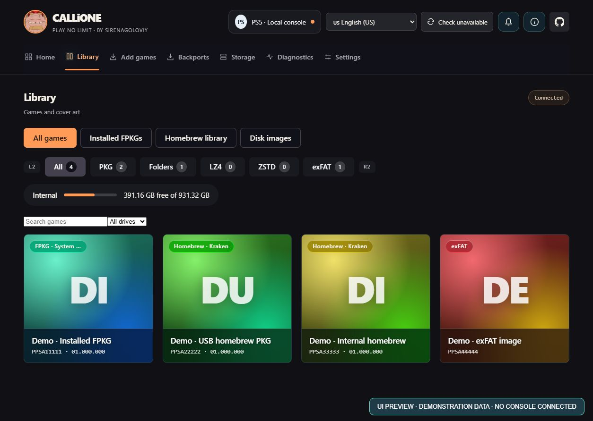

# CALLiONE

**PLAY NO LIMIT · BY SIRENAGOLOVIY**

[English](#english) · [Русский](#русский)

## English

### Introducing CALLiONE

CALLiONE is an all-in-one payload project for a jailbroken PS5, developed from TITAN. It brings system FPKGs, a Kraken homebrew library and ShadowMount disk images into one interface, while keeping their launch paths separate.

**Status: private testing. This repository contains the announcement and interface screenshots only. No source code, ELF files or downloadable builds are published here.**

### Three ways to play, one library

| Your content | What handles it |
| --- | --- |
| System-installed FPKGs | The PS5 system and kstuff; Kraken does not convert them into homebrew games. |
| Compatible homebrew PKGs and game folders | Kraken / AMPR, restricted to the internal and external `homebrew` folders. |
| Supported disk images, including `.exfat` | ShadowMountPlus. |

The goal is to keep native installation available for system games and retain external-drive homebrew launching for compatible content.

### Adding games

- **Install to PS5:** choose a compatible FPKG on a connected drive or in the internal FTP inbox. Installation uses the system package installer through ShadowMountPlus. The PS5 chooses the installation destination; CALLiONE displays the installation task and progress.
- **Copy to homebrew:** a separate action copies a compatible PKG into the chosen drive's homebrew library for Kraken. It preserves the source file.
- **FTP inbox:** transfer installation packages to `/data/pkg-install/`. Kraken does not scan this folder. Wait for the transfer to finish before installing; uploading as `.part` and renaming to `.pkg` afterwards helps avoid incomplete files being selected.
- **Kraken folders:** `/data/homebrew/` internally and `homebrew/` on supported external drives. System-installed games remain on the system launch path.

### Inside the interface

- A shared library with separate filters for installed FPKGs, homebrew and disk images.
- Separate system installation and homebrew copying workflows.
- Storage browsing, installation progress and diagnostic logs.
- English and Russian interface options, plus other inherited translations.
- PlayGo compatibility settings for the Kraken path, with game selection.
- A backport catalog interface for configured compatible sources. This announcement does not include game patches or a verified universal backport catalog.

### English interface preview

These screenshots show the current PC interface preview with **synthetic demonstration data**. No console is connected. Storage figures, game entries and connection indicators are mock data, not compatibility or performance test results. The interface may change before a public build.

**Home**

**Library: system FPKGs, Kraken homebrew and disk images**

**Add games: choose system installation or homebrew copying**

### Testing and availability

Testers have reported successful system FPKG operation in private builds. Broader testing is ongoing: compatibility depends on firmware, package format, game requirements and the selected runtime. Support for every game or firmware is not promised, and there is no public release date yet.

When reporting a problem, include the CALLiONE build, PS5 firmware, game Title ID and version, content format, internal/external drive, steps to reproduce and the relevant log. The CALLiONE log path is `/data/callione/callione.log`.

### Credits

CALLiONE builds on the work of the PS5 homebrew community:

- [TITAN](https://github.com/grimmtroll2285-dot/TITAN), including the TITAN CORE foundation by devchmod.
- [Kraken Mount](https://github.com/quer3q/kraken-mount) and [ampr-emu-ng](https://github.com/quer3q/ampr-emu-ng) by quer3q and contributors.
- [kstuff-lite](https://github.com/EchoStretch/kstuff-lite), EchoStretch and the kstuff contributors.
- [ShadowMountPlus](https://github.com/drakmor/ShadowMountPlus) by drakmor and contributors, and the PlayGo compatibility work used by the project.
- [PS5 payload SDK](https://github.com/ps5-payload-dev/sdk) and its contributors.

Thanks to the testers who help check real-console behavior, including **@ImN3k1t** and **@script_durova**.

---

## Русский

### Представляем CALLiONE

CALLiONE — проект единой надгрузки для взломанной PS5 на основе TITAN. Он объединяет системные FPKG, библиотеку homebrew через Kraken и образы ShadowMount в одном интерфейсе, сохраняя отдельный способ запуска для каждого типа игр.

**Статус: закрытое тестирование. Здесь опубликованы только анонс и скриншоты интерфейса. Исходников, ELF и сборок для скачивания в этом репозитории нет.**

### Три способа запуска в одной библиотеке

| Ваш контент | Кто за него отвечает |
| --- | --- |
| Установленные в систему FPKG | Система PS5 и kstuff. Kraken не превращает такие игры в homebrew. |
| Совместимые homebrew PKG и папки игр | Kraken / AMPR, только внутри папок `homebrew` на внутреннем и внешних накопителях. |
| Поддерживаемые образы, включая `.exfat` | ShadowMountPlus. |

Задача — сохранить системную установку игр и возможность запускать совместимый homebrew с внешнего накопителя.

### Как добавлять игры

- **Install to PS5 — установить в систему:** выбрать совместимый FPKG на подключённом накопителе или во внутренней папке для FTP. Установка идёт через системный установщик и ShadowMountPlus. Место установки определяет PS5, а CALLiONE показывает задачу и прогресс.
- **Copy to homebrew — скопировать для Kraken:** отдельное действие копирует совместимый PKG в homebrew-библиотеку выбранного накопителя. Исходный файл сохраняется.
- **Папка для FTP:** `/data/pkg-install/`. Kraken её не сканирует. Перед установкой дождитесь окончания передачи. Можно загружать файл с расширением `.part`, а после завершения переименовать в `.pkg`, чтобы не выбрать недокачанный файл.
- **Папки Kraken:** `/data/homebrew/` внутри консоли и `homebrew/` на поддерживаемых внешних накопителях. Установленные системные игры запускаются своим способом.

### Что есть в интерфейсе

- Общая библиотека с фильтрами установленных FPKG, homebrew и образов.
- Отдельные действия для системной установки и копирования в homebrew.
- Просмотр накопителей, прогресс установки и журналы диагностики.
- Английский и русский интерфейс, а также другие унаследованные переводы.
- Настройки совместимости PlayGo для Kraken с выбором игр.
- Интерфейс каталога бэкпортов для настроенных совместимых источников. Сам анонс не содержит патчей игр или проверенного универсального каталога бэкпортов.

### Скриншоты

Выше показаны три экрана на английском: **главная**, **библиотека** и **добавление игр**. Это предпросмотр на ПК с вымышленными демонстрационными данными, без подключения к консоли. Объём накопителей, записи игр и индикаторы подключения не являются результатами тестов совместимости или производительности. До публичного выпуска интерфейс может измениться.

### Тестирование и доступность

Тестеры подтвердили работу системных FPKG в закрытых сборках. Остальные сценарии продолжаем проверять. Совместимость зависит от прошивки, формата пакета, требований игры и выбранного движка. Поддержку всех игр и прошивок не обещаем; даты публичного выпуска пока нет.

При ошибке нужны версия CALLiONE, прошивка PS5, Title ID и версия игры, формат, внутренний или внешний накопитель, действия перед ошибкой и соответствующий лог. Журнал CALLiONE: `/data/callione/callione.log`.

### Благодарности

Проект использует работу сообщества PS5: основу **TITAN CORE от devchmod**, TITAN, **Kraken Mount и ampr-emu-ng от quer3q**, работу **EchoStretch и других участников kstuff**, **ShadowMountPlus от drakmor**, разработки совместимости PlayGo и **PS5 payload SDK**. Ссылки на проекты приведены в английском разделе выше.

Спасибо тестерам за проверки на настоящих консолях, в том числе **@ImN3k1t** и **@script_durova**.
